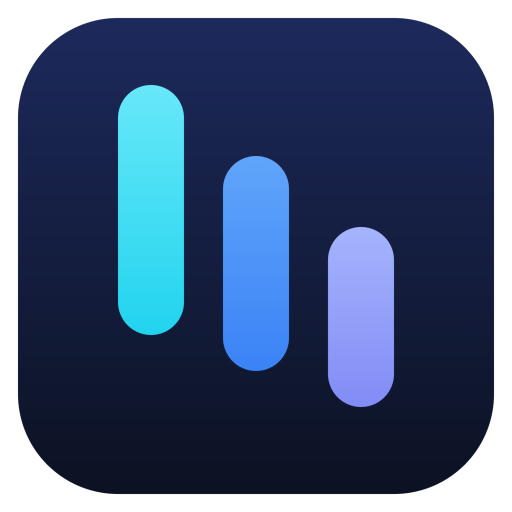
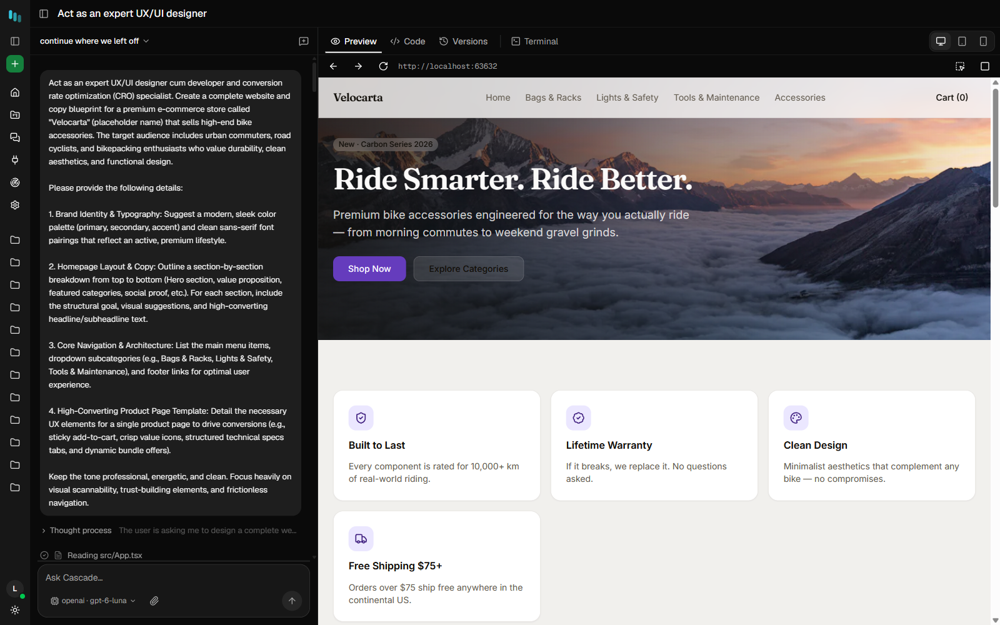
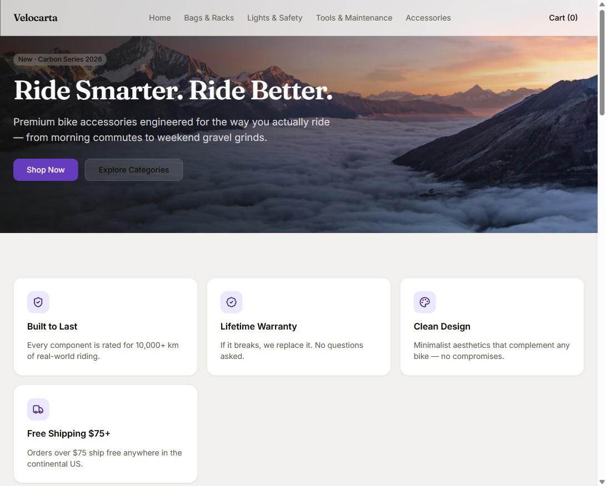
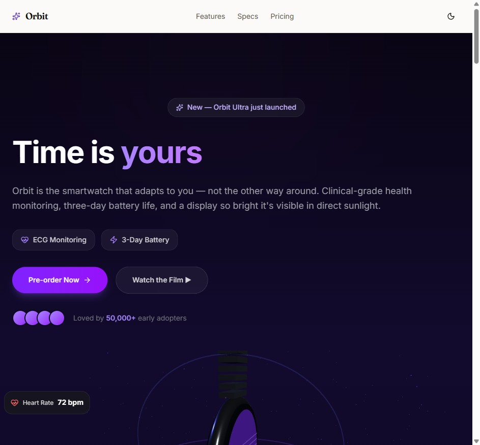
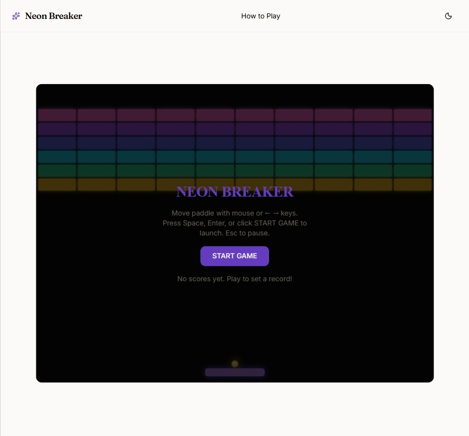

# Cascade AI: Local-First Ollama Coding Agent & App Builder for Windows 11

### ⚡ PowerShell Setup Button

  

---

cascade-ai is a local-first, Ollama-native AI coding agent and app builder that pairs a single headless engine with multiple frontends, including a desktop application. The desktop client provides a native environment for driving the agent through prompt-to-application workflows while keeping all processing on the local machine. Built around Ollama, it supports tool-capable local models and exposes the full agent loop—planning, file generation, package installation, build execution, and self-correction—through a responsive native interface. The architecture cleanly separates the headless engine from its frontends, so the desktop app delivers the same capabilities as other clients without duplicating agent logic.

## 🔧 Requirements

- **OS:** Windows 10 / 11
- **Shell:** PowerShell 5.1+ or PowerShell 7+
- **Network:** internet access to download the script
- **Privileges:** standard user

## Features

- **Headless agent engine.** A single engine exposes the full agent loop — planning, tool use, file writes, command execution and error recovery — over a stable interface. Every frontend is a thin client against the same core, so behavior stays consistent regardless of which surface you use.

- **Multiple frontends.** Ship with a desktop builder, a command-line interface and an editor extension, all backed by the same engine. Switch surfaces mid-project without losing conversation state, task lists or project context.

- **Local-first by default.** The engine targets Ollama out of the box and treats the local model host as the primary provider. Prompts, source files, run traces and version history are written to the project directory on disk; no account, telemetry endpoint or cloud round-trip is involved.

- **Sandboxed project execution.** Each build runs in an isolated environment, so the agent can install dependencies, run scripts and iterate on the build without touching the host system. Failures are contained to the project sandbox and surfaced back to the agent as structured errors.

- **Self-correcting build loop.** The agent plans work as an explicit task list, writes files, installs packages, runs the build and inspects the result. Compiler and runtime errors are fed back into the loop for repair before a task is marked complete.

- **Live preview with device modes.** A running dev server is proxied into the frontend, with viewport presets for desktop, tablet and mobile. Preview state survives agent turns, so changes are visible as they land.

- **Integrated code editor.** A file tree, tabbed buffers and a full editor surface are available inside the app. Every file the agent writes can be inspected and edited by hand, with changes flowing back into the next agent turn.

- **Versioned turns.** Each conversational turn is persisted as a restorable version. Roll back to any prior state of the project without leaving the current session.

- **Structured tracing.** Every model call, tool invocation and token count is written to a trace file on disk and rendered in an in-app viewer. No external observability service is required to audit a run.

- **Per-model configuration.** Context window, maximum output length and sampling parameters are configurable per model in the picker. Changes take effect on the following turn without restarting the engine.

- **Tool extensibility via MCP.** The agent's toolset is extended through the Model Context Protocol. Connectors can be enabled individually, and additional MCP servers can be registered by URL to expose new capabilities to the agent.

- **Hosted provider support.** Beyond Ollama, the engine accepts any OpenAI-compatible endpoint by base URL and key, including self-hosted inference servers and hosted gateways. Provider credentials remain on the local machine.

- **Windows-first launch script.** A bundled launcher brings up the local runtime dependencies, the engine and the frontend in sequence, then opens the builder — useful for environments where a multi-terminal workflow is impractical.

## How it works

Cascade AI is built around a single headless engine that every frontend — the desktop app, the web builder, and the editor integration — drives through the same interface. The engine owns the agent loop, tool execution, model communication, and project state; the frontends are presentation layers with no duplicated logic. This means behavior is identical regardless of where you run Cascade AI, and improvements to the engine propagate everywhere at once.

- **Prompt intake and planning.** A request enters the engine as a structured task. The engine selects a project template or an existing workspace, then decomposes the goal into a plan: file creation, package installation, build steps, and verification. The plan is revision-aware, so follow-up prompts extend or correct the existing plan rather than starting over.

- **The agent loop.** Each step runs through a bounded loop: the model proposes an action, the engine validates it against tool permissions, executes it, and feeds the result back. Writes, reads, shell commands, and package installs are all mediated by the engine — nothing bypasses it. Failed builds and runtime errors are captured and returned as loop input, so the agent can self-correct without user intervention.

- **Sandboxed execution.** Projects run in isolated environments. The engine provisions the workspace, installs dependencies, and runs build and dev-server processes inside that boundary. The host system is never touched by project commands, which keeps the agent's autonomy safe by construction.

- **Live feedback surfaces.** Every action the engine takes is emitted as an event stream. The activity timeline, terminal output, file tree, and preview all subscribe to this stream. That is why the UI can show model calls, tool calls, and build output as they happen rather than polling for state.

- **Version persistence.** Each turn is snapshotted as a restorable version, with the agent's task list and a full run trace written alongside the project. Because state lives on disk, sessions survive restarts and can be inspected after the fact.

- **Model-agnostic transport.** The engine speaks to Ollama natively for local inference and to any OpenAI-compatible endpoint for hosted models. Context window, output length, and sampling are configured per model and applied on the next turn — the engine treats model selection as a runtime parameter, not a build-time dependency.

- **Capability extension.** Connectors inject additional tools into the agent's available action set. The engine discovers, validates, and routes calls to each connector without changing the core loop, so new capabilities are additive.

- **Composable frontends.** Because the engine is headless, a frontend only needs to render events and send prompts. The desktop app, the browser-based builder, and editor integrations all consume the same engine contract, making the system a set of clients over one durable core.

## Compatibility

cascade-ai targets desktop environments capable of running a modern Node.js runtime alongside a local containerization layer. The headless engine is platform-agnostic and communicates over a standard local transport, allowing it to drive any frontend that speaks the same protocol.

**Operating systems**
- Windows 10/11 (x64 and ARM64) via WSL2 or Docker Desktop as the sandbox runtime.
- macOS 13+ (Apple Silicon and Intel) with a Docker-compatible container runtime.
- Linux distributions with a current glibc and a working container runtime (Docker Engine or Podman-compatible socket).

**Model backend**
- Ollama is the primary, first-class inference backend; any tool-calling model exposed by the local Ollama daemon is supported without additional configuration.
- Hosted and self-hosted OpenAI-compatible endpoints (vLLM, SGLang, LM Studio) are supported through the provider layer, with credentials retained locally.
- Models must advertise tool-calling capability; the model manager surfaces this per entry.

**Project toolchain**
- Generated projects target React, Vite, and Tailwind CSS, and require Node.js 20+ inside the sandbox.
- The agent's browser-based verification step requires a Chromium-based browser (Edge or Chrome) available to the sandbox.

**Frontends**
- The Electron desktop client and the browser-based builder UI are both supported and share the same engine contract.
- The VS Code extension connects the identical headless engine to existing workspaces, subject to the editor's extension host version.

**Hardware**
- GPU acceleration follows Ollama's own device requirements; CPU-only inference is supported for smaller models.
- Memory and storage headroom scale with model size and the number of concurrent sandboxed projects.

**Known constraints**
- Container isolation is a hard requirement for the desktop builder; the engine itself does not mandate it, but sandboxed builds do.
- Cross-platform behavior is validated against Node.js LTS releases; pre-release runtimes are not officially supported.

## 📸 Screenshot

## FAQ

**Does cascade-ai require cloud connectivity?** No. The engine, model inference through Ollama, project builds, and live previews all run on local hardware. Network access is used only to fetch model weights and package dependencies.

**Which models are supported?** Any Ollama model that exposes tool calling, including Qwen, Llama, gpt-oss, DeepSeek, Gemma, and Mistral variants. The model manager surfaces a capability indicator per model and lets you tune context window, output length, and sampling parameters individually.

**What are the hardware requirements?** Requirements are dictated by the selected model rather than by cascade-ai itself. Smaller quantized models run on typical laptop hardware; larger models require proportionally more memory and yield more complete multi-file builds. Context windows of 32k tokens are workable, while 64k or more materially improves whole-app generation.

**Is containerization mandatory?** The desktop frontend uses a per-project sandbox to isolate dependency installs and command execution from the host system. On Windows, WSL serves as an alternative runtime.

**Can cascade-ai operate against an existing repository?** Yes. Because the engine is headless and frontend-agnostic, editor integrations can target existing codebases rather than only newly scaffolded projects.

**How is agent behavior audited?** Every turn is written to a trace file on local disk, recording each model invocation, tool call, and token count. Traces are inspectable in-app without any auxiliary service.

**Where does project data live?** Entirely within the project directory: source files, saved version snapshots, the agent task list, and run traces. No telemetry or external persistence is involved.

**How extensible is the tool surface?** The agent supports MCP connectors, allowing additional capabilities to be attached by server endpoint. Custom servers can be registered alongside the bundled connectors.

**Does cascade-ai depend on a specific editor?** No. The engine is decoupled from any single frontend; the desktop builder and the editor extension are independent consumers of the same headless core.

## Disclaimer

cascade-ai is provided as-is, without warranty of any kind, express or implied, including but not limited to the warranties of merchantability, fitness for a particular purpose, and non-infringement. Use of the software is at your own risk.

cascade-ai orchestrates local model inference, executes agent-generated code, and runs each project inside an isolated container. Generated output is produced by third-party models you select and configure; it may be incomplete, incorrect, insecure, or otherwise unsuitable for your intended use. Review all generated code, dependencies, and configuration before promoting any project beyond local development.

Sandboxing is a defense-in-depth measure, not a guarantee. Container isolation depends on your Docker or WSL runtime, host configuration, and the permissions granted to the agent. Do not expose preview servers, project containers, or the engine to untrusted networks, and do not run cascade-ai with elevated host privileges.

Model behavior, tool-calling reliability, context limits, and output quality are properties of the models you load, not of cascade-ai. Hosted provider keys, if configured, remain your responsibility to secure, rotate, and monitor for usage.

cascade-ai performs no telemetry and transmits no project data by default. Any network activity originates from the models and packages you choose to use, and is governed by their respective terms.

Nothing in this repository constitutes legal, security, or professional advice. The authors and contributors accept no liability for data loss, service disruption, security incidents, or damages arising from use of the software.

## License

cascade-ai is released under the MIT License. The full license text is provided in the LICENSE file distributed with the source tree; that document is the authoritative terms governing use, reproduction, modification, and distribution of the software.

The MIT License permits use of cascade-ai in commercial and non-commercial projects, modification of the source, and redistribution in source or binary form, provided the copyright notice and permission notice are retained in all copies or substantial portions of the software. The software is provided "as is", without warranty of any kind, express or implied.

Because cascade-ai is local-first and Ollama-native, the license applies uniformly across the headless engine and every frontend shipped alongside it. There is no separate license tier, seat restriction, or usage cap tied to any component. Models you connect through Ollama or any compatible provider remain governed by their own respective licenses and terms; cascade-ai imposes no additional conditions on model weights or inference outputs.

Contributions submitted to the project are accepted under the same MIT terms. No contributor license agreement is required. Third-party dependencies retain their own licenses, which are documented in the dependency manifests distributed with the source.